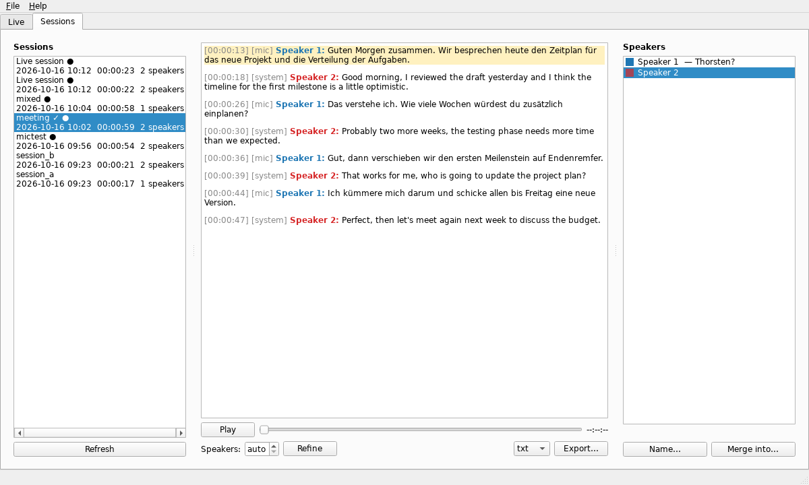

# transcribe

Local, privacy-preserving live audio transcription with speaker identification
for Windows, Linux and macOS. CLI (`tx`) and Qt GUI share one headless core.

See [docs/PLAN.md](docs/PLAN.md) for the architecture and roadmap and
[docs/BENCHMARKS.md](docs/BENCHMARKS.md) for measured accuracy and speed.

## Status
- **M0** core: transcript model, event bus, plugin registry, config, exporters
  (txt/md/srt/vtt/json), LocalAgreement streaming policy, online speaker clustering,
  voiceprint DB + open-set matching.
- **M1** file transcription: `tx transcribe FILE` — faster-whisper + sherpa-onnx
  diarization (pyannote segmentation 3.0 + WeSpeaker ResNet34), fully local, CPU or CUDA.
- **M2** live transcription: `tx live` — microphone capture, streaming ASR
  (LocalAgreement-2), provisional live speaker labels, crash-safe recording, and a
  refinement pass (full offline pipeline) when the session stops.
- **M3** voiceprints: people are recognised across sessions. Name a speaker once
  (`tx speakers name`) or enroll from audio (`tx speakers enroll`); later sessions label
  them automatically or ask "might be X?". Consent, no-storage mode, encryption at rest.
- **M4** desktop app (`tx gui` / `tx-gui`): live view, speaker panel (name, merge,
  "Is this X?" suggestions), session browser with playback synced to the text, export,
  refine, settings and a voiceprint manager (consent, enrollment, deletion).
- **M6** packaging: PyInstaller bundles (CLI + desktop app) for Linux, Windows and macOS
  built by GitHub Actions; first-run model download; CI on all three platforms.
- **M5** system audio: transcribe what the computer plays (`--source system`), or
  microphone + system audio as separate channels (`--source both`) with echo suppression
  - the basis for recording Zoom/Teams/Jitsi calls.
- **whisper.cpp engine** (`--engine whisper.cpp`): GPU acceleration on AMD/Intel (Vulkan)
  and Apple (Metal) GPUs.

## Install
```sh
uv sync                      # in the repo: project .venv incl. desktop app, then `uv run tx ...`
uv sync --all-extras         # + encryption (secure) and Windows system audio (system)
pip install .                # or into any venv (also `uv pip install .`), then `tx ...`
pip install ".[gui]"         # + desktop app; extras: gui, secure (encryption), system (Windows)
```
`uv sync` removes extras you don't name again - use the same flags after every
`git pull` (`--no-group gui` for a CLI-only environment).
Linux also needs the PortAudio library for microphones (`apt install libportaudio2`).
Note: `uv run` always uses the project's `.venv`, not an activated venv (`uv run --active`
uses the active one).

## Usage
```sh
uv run tx transcribe meeting.m4a                 # de/en auto, speakers auto
uv run tx transcribe talk.mp3 -n 2 -l de -f srt -o talk.srt
uv run tx export <session-dir> -f md
uv run tx models list

uv run tx devices                                # list microphones
uv run tx live -i "USB" -n 3                     # Ctrl+C stops, then refines
uv run tx live --file meeting.wav                # replay a file in real time (testing)
uv run tx refine <session-dir> -m medium         # re-run refinement, e.g. bigger model
```
Any format ffmpeg reads works (decoded via PyAV). Models download on first use to the
user cache dir (override with `TRANSCRIBE_MODELS_DIR`); sessions are stored under the user
data dir (`sessions_dir` in `config.toml`).

**Settings** live in `config.toml`, which the app's **Settings** dialog writes; you can also
edit it by hand (only the keys you set, the rest uses defaults; CLI flags override it):

| OS | `config.toml` |
|---|---|
| Linux | `~/.config/transcribe/config.toml` |
| macOS | `~/Library/Application Support/transcribe/config.toml` |
| Windows | `%LOCALAPPDATA%\transcribe\transcribe\config.toml` |

### Language of the app (English, Deutsch)
The CLI and the desktop app speak English and German. By default they follow the system
language; choose explicitly in **File → Settings → General → Language** (applies after
a restart), with `[ui] language = "de"` in `config.toml`, or for one run:
```sh
TRANSCRIBE_LANG=de uv run tx gui
TRANSCRIBE_LANG=en uv run tx transcribe talk.mp3
```
Default speaker names follow the language too ("Sprecher 1"), also in exports; names you
give stay as they are. Transcription languages are a separate setting (`--lang`).

**Translations** are gettext `.po` files in `src/transcribe/locale/` (edit with Poedit,
Weblate or any text editor). After changing UI text in the code, run
`python scripts/i18n.py` to collect new strings into the catalogs; `uv run pytest` fails
while a string is untranslated or a translation loses a placeholder. A new language:
copy `de.po` to `<code>.po`, translate, and add the code to `LANGUAGES` in
`src/transcribe/i18n.py`.

### Mixed German/English
Whisper detects one language per call and can't be limited to a subset, so the pipeline
detects a language **per speaker** (restricted to `--lang`, default `de,en`), then
transcribes runs of same-language turns with the language pinned. Without diarization,
VAD regions serve as the language units. Limitation: one speaker switching language
mid-recording is transcribed in their dominant language.

### Custom vocabulary (names, acronyms, jargon)
Whisper guesses unknown names phonetically ("Fanfress" for *Fentriss*). Give it hints:
```sh
tx transcribe folge1.m4a --vocab "Justus, Peter, Bob, Fentriss, Hitchcock"
tx transcribe meeting.m4a --vocab-file vocab.txt
```
`vocab.txt` - one entry per line, `#` comments, `wrong -> right` corrections:
```
# cast
Justus, Peter, Bob
Fentriss
DSGVO          # acronyms and jargon work the same way
Fanfress -> Fentriss          # fix what the model still mishears
Mr Fan Fress -> Mr. Fentriss  # multi-word, keeps the timestamps
```
- Hint words are passed to Whisper as *hotwords* for every 30 s window (not just the
  start); keep the list short (~100 words) - it shares Whisper's prompt space.
- Corrections run on the recognised words (case-insensitive, whole words) in file
  transcription, live mode and refinement.
- Permanent entries: `[asr] vocabulary = [...]` and `[asr.corrections]` in
  `config.toml`, or **File → Settings → Edit vocabulary…** in the app. `--vocab` /
  `--vocab-file` add to them for one run.

### Speaker accuracy
Speakers are found in two passes: the diarizer (pyannote segmentation + NeMo TitaNet-small
voice embeddings), then
a second pass that cuts the transcript into phrases (sentence ends, pauses ≥ 0.5 s),
embeds each phrase and clusters them again. This fixes the diarizer's typical errors:
merged turns in fast dialogue, mixed clusters, and far too many speakers.

| Word speaker accuracy (purity) | diarizer only | + second pass (default) |
|---|---|---|
| AMI meeting ES2004a (4 people) | 54.8 % (52 speakers) | 79.5 % / 99.2 % (15) |
| AMI meeting IS1009a (4 people) | 33.3 % (52) | 81.1 % / 97.2 % (15) |
| synthetic radio play (6 voices) | 62.1 % (8) | 96.7 % / 99.2 % (7) |

Purity = share of words whose label holds only that person's voice (extra labels are
fixed by merging, mixed voices are not). With the previous voice model (ResNet34) the
second pass reached 69.0 / 83.1 / 88.5 % at a purity of 98.5 / 90.1 / 92.6 %.

On a 50-minute radio play (no reference): 21 → 13 speakers, segments starting
mid-sentence 22 % → 2 %.

- **Pass `--speakers N` when you know the count** - the most reliable setting.
- Without it the default may **over-split** (one person → two labels); merge them in the
  app or with `tx speakers` - merged voices could not be separated again.
- `[speakers] speaker_count = "silhouette"` picks the count from the voices themselves:
  best for meetings with distinct voices (ES2004a: 99.2 %, exactly 4 speakers), but it
  can merge similar voices (IS1009a: 3 speakers for 4 people; a radio play's young
  voices into 3).
- Similar voices (e.g. several teenage boys in one studio) stay the hardest case.
- Numbers come from three recordings. Reproduce the AMI rows with
  `python -m transcribe.bench.diarization` (downloads ~60 MB; ~10 min on CPU).

### Live mode
- Partial text appears as you speak (dim = may still change); an utterance is finalized
  at the first pause of ~0.6 s. Median latency from end of speech to final text is ~3 s
  on CPU with `small` (16-core test machine). Every decode costs a full Whisper encoder
  pass (~1.3 s for `small` on CPU, regardless of thread count), so on slower machines use
  `-m base` live and set `[live] refine_model = "small"` (or larger) in `config.toml`.
- With several languages allowed, an utterance is only decoded once its language is
  known (≥1.5 s of speech): Whisper pinned to the wrong language translates instead of
  transcribing.
- Live speaker labels: every **sentence** gets its own label (people often answer
  without the pause that ends an utterance), assigned to the most similar voice heard so
  far or to a new speaker; a label never changes once shown. In replayed recordings
  81-91 % of the speech is labelled correctly live (previously 29-73 %; see
  [benchmarks](docs/BENCHMARKS.md#live-speaker-labels)). `[speakers] live_threshold`
  (default 0.4) trades merged voices against extra labels; telephone-band channels
  (phone lines, some calls) are detected and use `live_threshold_narrowband` (0.6), as
  voices sound more alike there. The refinement pass on stop
  is authoritative; `--no-refine` keeps the live result. Both are saved
  (`transcript.live.json`, `transcript.json`).
- Audio is recorded as 30 s FLAC parts while running, so a crash loses at most 30 s;
  `tx refine` works on an interrupted session.
- Linux needs the PortAudio library for microphone input (`apt install libportaudio2`);
  the Windows/macOS wheels bundle it.

### GPU acceleration on AMD, Intel and Apple (whisper.cpp engine)
faster-whisper uses the CPU or an NVIDIA GPU. For other GPUs, the `whisper.cpp` engine
runs Whisper through [whisper.cpp](https://github.com/ggml-org/whisper.cpp) (Vulkan,
Metal, CUDA or CPU). On a Radeon 780M iGPU, `large-v3-turbo` ran 4× faster than on the
CPU of the same machine and fast enough for live mode (4 s latency; see
[benchmarks](docs/BENCHMARKS.md#whispercpp-engine)).
```sh
scripts/build_whispercpp.sh            # whisper-server: CPU + Vulkan (macOS: Metal)
uv run tx transcribe talk.mp3 --engine whisper.cpp -m large-v3-turbo
uv run tx live --engine whisper.cpp --device gpu
```
or permanently in `config.toml` (see [Usage](#usage) for its location), e.g. for a
Radeon 780M iGPU - `small` live (1.8 s latency), `large-v3-turbo` for the final
transcript (0.1× real time):
```toml
[asr]
engine = "whisper.cpp"
model = "small"
device = "auto"                 # auto (GPU build if present) | gpu | cpu
whispercpp_server = ""          # path to any whisper-server; "" = own build, then PATH
whispercpp_dtw = true           # accurate word times (speaker attribution)

[live]
refine_model = "large-v3-turbo" # used when a live session stops
```
`refine_model` applies to the pass after a live session; `tx transcribe` and `tx refine`
use `model` - add `-m large-v3-turbo` for files, or set `model = "large-v3-turbo"` and
accept 4 s live latency.
- The engine starts `whisper-server` as a child process (the model stays loaded, also
  for live mode) and talks to it on `127.0.0.1`. ggml models download on first use
  (`tx models download` fetches the configured ones as `ggml:<model>`).
- The script needs cmake and a C++ compiler, for Vulkan also the Vulkan headers and
  `glslc` (Debian/Ubuntu: `apt install cmake g++ libvulkan-dev glslc`). On Windows,
  build whisper.cpp per its README and set `whispercpp_server`. NVIDIA GPUs work with
  both engines.
- Accuracy and word timing match faster-whisper (same Whisper models, same VAD); custom
  vocabulary and the style prompt work the same way. On a CPU without a usable GPU,
  stay with faster-whisper: it is as fast for files and faster live.

### Desktop app
```sh
uv sync
uv run tx gui
```


- **Live:** pick microphone, system audio or both; partial text appears dimmed, finished
  lines get coloured speaker labels. Naming a speaker while recording applies at once;
  the voice is learned (with the consent checkbox ticked) when the session stops.
- **Sessions:** click a timestamp to play from there; the playing line is highlighted.
  Fix diarization by merging speakers, accept or decline suggestions, refine (optionally
  with a known speaker count), export. Correct single lines - see below.
- **File → Settings:** engine and models, speakers, live mode, voiceprint thresholds,
  storage; the vocabulary has its own editor (import/export a list, shows how many hint
  words fit Whisper's prompt).
- **File → Voiceprints:** everyone with stored voiceprints - add a person, enroll a voice
  from a recording, record or withdraw consent, rename, merge, notes, list and delete
  single voiceprints, import/export, delete.
- The GUI is a thin layer over the same core as the CLI (`transcribe.sessions`,
  `transcribe.live.factory`); core events reach the Qt thread through a signal bridge,
  model loading and refinement run in background threads.

### Correcting a transcript (speakers and text)
Speaker detection mixes up similar voices; fix it by hand, in the app or on the command
line. Changes are saved in the session's `transcript.json`; export afterwards.

**App (Sessions tab):**
- **Right-click a line → Speaker of this line**: pick a speaker or **New speaker…**.
  Select several lines first (drag over them) to reassign them in one go.
- **Double-click a line** (or right-click → Edit text…) to correct the text. Put a line
  break where the speaker changes to split the line, then assign the parts. Delete all
  text to remove a line.
- **Speakers panel:** *Name…* renames, *Merge into…* joins two labels of one person.

**Command line** (`SESSION` = folder, its name in the sessions directory, or `latest`):
```sh
tx sessions list                                   # stored sessions
tx sessions speakers latest                        # ids, names, lines, speaking time
tx sessions merge latest S7 S6                     # S6 is the same person as S7
tx sessions rename latest S7 Justus
tx sessions assign latest 20:22-24:27 Carlos --from Justus   # new speaker if unknown
tx sessions assign latest 13:09 "Miss Wegner"      # the line(s) starting at 13:09
tx sessions edit latest 3:35 "Ihr seid also hier, weil ihr den Papagei sucht."   # fix text
tx sessions edit latest 1:17 "Hinter dir ein Mann!|Was?"   # split: then assign the parts
```
Times are line starts as shown in the transcript (`mm:ss`, `hh:mm:ss`, or seconds); a
range covers all lines starting in it. In `edit`, `|` splits the line; word timings are
kept where words are unchanged, so playback and subtitles stay in sync.

Stored voice samples follow the corrections (a line moved to another speaker takes its
samples along). When you later enroll a speaker (*Name…* with "learn this voice", or
`tx speakers name`), the corrected lines are used.

### System audio / calls (`--source system|both`)
```sh
uv run tx devices                         # inputs + system-audio sources
uv run tx live -s both -n 3               # you (mic) + call participants (system audio)
uv run tx live -s system --output <id>    # only what a given output device plays
uv run tx live -s both --mix              # one summed stream: cheaper on CPU
```
**Check the devices first:** `tx levels` shows a live meter for every microphone (🎤,
`--input`) and every system-audio source (🔊, `--output`). Speak and play something in
the meeting app: the rows that move are the devices to use. `tx levels -i <mic> --output
<id>` shows only those two. During `tx live`, the status bar has one meter per channel.
In the app, each device picker has a meter that previews the selected device while idle
(and shows the session level while recording); **Check devices…** lists all devices with
meters and a "Use" button.

| Platform | System audio capture | Status |
|---|---|---|
| Linux | PulseAudio/PipeWire monitor via `parec` (pulseaudio-utils) | tested (PulseAudio 17) |
| Windows | WASAPI loopback via `soundcard` (extra `system`) | **untested** |
| macOS 14.2+ | Core Audio process tap, Swift helper `helpers/macos-audiotap` | **not yet compiled/tested** |
| macOS < 14.2 | BlackHole virtual device selected as `--input` | - |

- `both` keeps two channels (`mic`, `system`): remote participants and you are separated
  by channel, each channel is recorded (`audio-mic.flac`, `audio-system.flac`) and
  refined separately. Without a headset the mic hears the speakers: a mic segment that
  repeats overlapping system audio is dropped as echo (`echo_segments_dropped` in the
  transcript meta). Two ASR streams double the CPU load - `--mix` sums both into one
  stream (no echo suppression, and live speaker labels are weaker; refinement helps).

### Voiceprints (speaker identification across sessions)
```sh
uv run tx transcribe meeting.m4a                      # speakers S1, S2, ...
uv run tx speakers name <session> S2 "Alice" --consent  # label + learn Alice's voice
uv run tx speakers enroll "Bob" --file bob.wav --consent  # or --record 30
uv run tx transcribe next_meeting.m4a                  # "S1 is Alice (score 0.91)"
uv run tx speakers identify <session>                   # re-check after new enrollments
uv run tx speakers list | consent NAME --revoke | delete NAME | export F | import F
```
- Each session stores a few **exemplar embeddings** per speaker (`exemplars.npz`, from
  ≥3 s pieces of clean speech that never span a pause). Naming a speaker enrolls them.
- **Decisions:** a speaker is labelled only when the score is ≥ 0.75 *and* leads the best
  competitor by ≥ 0.10 (one person per session speaker); 0.60–0.75 gives a suggestion.
  Calibrated for TitaNet-small with `python -m transcribe.bench.calibrate --sweep` on
  synthetic voices: 0 wrong labels with the same, a different, or a phone-like channel
  (strangers scored ≤ 0.66) - a phone-like channel mostly yields suggestions. Real
  recordings will differ; re-run the bench with your own data before relying on it.
- **Voiceprints belong to one voice model.** Since TitaNet-small replaced WeSpeaker
  ResNet34 as default, older voiceprints are not used (File → Voiceprints says how many);
  enroll those people again.
- **Safety against diarization errors:** a speaker whose exemplars disagree (two voices
  merged) is never enrolled and never labelled confidently. A speaker with mixed
  languages is transcribed with per-turn language detection, so no speech is dropped.
- **Privacy (GDPR Art. 9 - biometric data):** everything stays local; enrolling requires
  `--consent` (recorded per person); `consent --revoke` deletes the person's voiceprints;
  `[speakers] store_voiceprints = false` disables all storage;
  `encrypt_voiceprints = true` (extra `secure`) encrypts DB vectors and session exemplars
  with a key kept in the OS keyring (or `TRANSCRIBE_VOICEPRINT_KEY`). Exports are
  unencrypted JSON - handle them as sensitive. Identification is for convenience only:
  not authentication, no anti-spoofing.
- Known limitation: diarization sometimes merges similar voices (e.g. two male voices);
  those speakers then stay unlabelled until refined (`tx refine -n N`).

## Installing a release
Download the archive for your platform from the GitHub releases page and unpack it. It
contains `tx` (command line) and `Transcribe` (desktop app); on macOS, `Transcribe.app`.
Models are not bundled: the app offers to download them on first start (or run
`tx models download`, several hundred MB, stored in the user cache directory).

- **Linux:** needs PortAudio and Qt's usual libraries (`apt install libportaudio2 libegl1
  libxkbcommon0`) and, for system audio, `pulseaudio-utils` (also for PipeWire).
- **Debian 13 / Ubuntu 24.04 and newer:** `sudo apt install ./transcribe_<version>_amd64.deb`
  instead pulls in those libraries and installs `tx` and `tx-gui` (with a menu entry). It
  conflicts with `transifex-client`, which also installs a `tx` command.
- **macOS:** grant microphone and "System Audio Recording" access when asked. Unsigned
  builds must be opened once via right-click → Open.
- **Windows:** system audio uses WASAPI loopback (no extra drivers).

Build a bundle yourself: `uv sync --group packaging --extra gui --extra
secure --extra system && uv run python packaging/build.py`
(on macOS run `helpers/macos-audiotap/build.sh` first). The Linux bundle is ~335 MB
(228 MB archived) and was verified here by transcribing with the frozen `tx`.
`packaging/linux/build_deb.sh` then wraps it in a .deb.

## Development
```sh
uv sync --all-extras
uv run pytest                 # fast unit tests (+ system-audio test if PulseAudio runs)
TX_SLOW=1 uv run pytest       # + end-to-end tests (downloads ~650 MB of models)
uv run python -m transcribe.bench.suite --help   # large-scale benchmark (docs/BENCHMARKS.md)
uv run python -m transcribe.bench.dialogue out.wav   # synthetic de/en test dialogue
uv run python -m transcribe.bench.latency out.wav small  # real-time live latency
uv run python -m transcribe.bench.calibrate --sweep      # voiceprint thresholds
```

## License

Copyright (C) 2026 Marcel Ritter

This program is free software: you can redistribute it and/or modify it under the terms of the GNU Affero General Public License as published by the Free Software Foundation, either version 3 of the License, or (at your option) any later version. See [LICENSE](LICENSE).

The release bundles and the Debian package also contain third-party libraries under their own (compatible) licenses, among them Qt/PySide6 (LGPL-3; Qt Virtual Keyboard GPL-3), FFmpeg (LGPL-3+, with the GPL-2+ x264/x265 encoders), CTranslate2, ONNX Runtime and faster-whisper (MIT) and sherpa-onnx (Apache-2.0). Speech models are downloaded on first use and are not part of the distribution.
